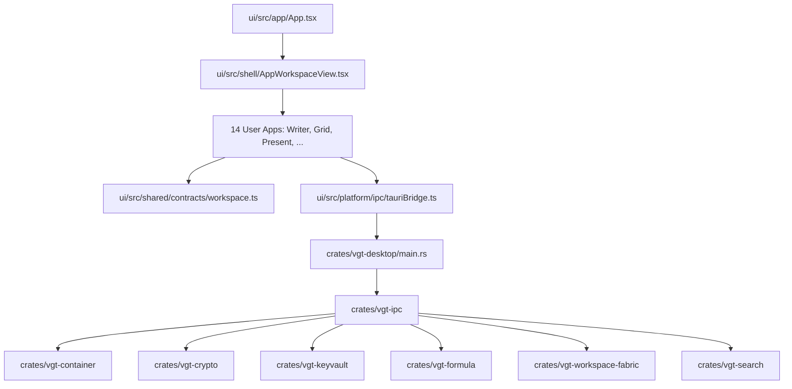

# ARCHITECTURE.md — Astraea Workspace Open-Core 0.1

> **VGT Analyticer Technische Architektur- & Codebasis-Landkarte**  
> **Stand:** 17.10.2026 · **Edition:** Astraea Workspace Open Core 0.1 (Windows Standalone)  
> **Repository:** Astraea Workspace Open Core — Alpha 0.1 source tree
> **Lizenz:** AGPL-3.0-only · **Technologie-Stack:** Rust (Tauri v2 Desktop Host, 22 Workspace Crates) + React 19, TypeScript 5.7, Tailwind CSS 3.4, Vite 6

---

## Architekturindex

1. [Systemübersicht](#1-systemübersicht)
2. [Globaler Architekturbaum](#2-globaler-architekturbaum)
3. [Dateizuordnung nach Systembereichen](#3-dateizuordnung-nach-systembereichen)
4. [Moduldokumentation (Alle 14 Benutzer-Apps & Rust-Subsysteme)](#4-moduldokumentation)
   - [Writer](#modul-writer)
   - [Grid](#modul-grid)
   - [Present](#modul-present)
   - [Notes](#modul-notes)
   - [PDF Studio](#modul-pdf-studio)
   - [Tasks & Work Management](#modul-tasks--work-management)
   - [Whiteboard](#modul-whiteboard)
   - [Vault](#modul-vault)
   - [Draw](#modul-draw)
   - [Publish](#modul-publish)
   - [Insight](#modul-insight)
   - [Connect](#modul-connect)
   - [Automate](#modul-automate)
   - [Admin & Policy](#modul-admin--policy)
5. [Dashboard- & Viewport-Architektur](#5-dashboard--und-viewport-architektur)
6. [CSS & UI-Design-System-Architektur](#6-css--und-ui-architektur)
7. [API- & IPC-Architektur (Tauri Host Bridge)](#7-api--und-ipc-architektur)
8. [Systemweite Datenflüsse](#8-systemweite-datenflüsse)
9. [Shared & Core Dependencies](#9-shared--core-dateien)
10. [Architektur-Relationen (Mermaid-Diagramme)](#10-architektur-relationen)
11. [Architektur-Auffälligkeiten & Verwaiste Dateien](#11-architektur-auffälligkeiten)

---

## 1. Systemübersicht

Astraea Workspace Open-Core ist eine sovereign, lokal-verschlüsselte Office- & Produktivitäts-Plattform für Windows. Sie kombiniert ein modulares React-19-Frontend mit einer sicherheitsgehärteten Rust-Laufzeitumgebung über Tauri v2.

### Kernprinzipien
1. **Local-First & Krypto-Souveränität:** Dokumente werden in `.vgt3` / `.vdoc` / `.vsheet` / `.vpres` Containern mit AES-256-GCM und Argon2id gesichert.
2. **Keine Cloud-Zwangsabhängigkeit:** Alle Operationen (Volltextsuche, Formelberechnung, PDF-Export, Versionierung) laufen lokal ab.
3. **Workspace Fabric:** Reaktiver Sync-Graph, der Live-Referenzen (z. B. ein Grid-Diagramm in Present oder Writer) konsistent hält.
4. **14 native Open-Core Apps:** Writer, Grid, Present, Notes, PDF Studio, Tasks, Whiteboard, Vault, Draw, Publish, Insight, Connect, Automate, Admin & Policy.

---

## 2. Globaler Architekturbaum

```text
ASTRAEA WORKSPACE OPEN-CORE 0.1
│
├── [RUST HOST & CRATES] (Backend / Runtime / Native System)
│   ├── crates/vgt-desktop                # Tauri Desktop Shell, App Entrypoint, Windowing
│   ├── crates/vgt-ipc                    # IPC Server & Auth Dispatcher
│   ├── crates/vgt-core                   # Basis-Typen, ID-Generierung, Fehler-Hierarchie
│   ├── crates/vgt-crypto                 # BLAKE3, AES-256-GCM, Argon2id, HKDF, X25519
│   ├── crates/vgt-keyvault               # Hardware-Attestation, Envelope Encryption
│   ├── crates/vgt-top-secret             # Abgeschirmte Geheimnis-Enklave
│   ├── crates/vgt-object-model           # WOM (Workspace Object Model) AST & Validierung
│   ├── crates/vgt-container              # VGT3 Container-Format (Pack/Unpack/Encrypt)
│   ├── crates/vgt-formula                # Spreadsheet Formula Evaluator (Excel/Calc Parität)
│   ├── crates/vgt-workspace-fabric       # Reaktive Cross-App Datenverknüpfung
│   ├── crates/vgt-syncgraph              # CRDT Multi-Master Synchronisationsgraph
│   ├── crates/vgt-netgate                # Airgap Firewall & URL Filtering
│   ├── crates/vgt-policy                 # RBAC, DLP & Compliance Policy Engine
│   ├── crates/vgt-search                 # Lokaler invertierter BM25 Volltext-Suchindex
│   ├── crates/vgt-automation-runtime     # Headless Trigger & Workflow Runtime
│   ├── crates/vgt-operations             # Reversible Operationstransformationen (Undo/Redo)
│   ├── crates/vgt-sandbox                # OS-Level Prozess-Isolation
│   ├── crates/vgt-plugin-runtime         # WASM/IPC Plugin Sandbox
│   ├── crates/vgt-diagnostics-release    # Crashdumps & geschützte Auditlogs
│   ├── crates/vgt-theme-assets           # Kompilierte Theme-Bundles & Assets
│   ├── crates/vgt-test-harness           # Regression- & Fuzzing-Runner
│   └── crates/vgt-cli                    # Standalone 'vgt' Entwickler-CLI
│
└── [FRONTEND] (ui/src)
    ├── app/                              # Root Bootstrapping, Seed-Daten & Context Provider
    ├── shell/                            # Workspace Shell, TabBar, Navigation, Overlays, Recovery
    │   ├── workspace/                    # AppWorkspaceView (Haupt-Viewport & Router für 14 Apps)
    │   ├── navigation/                   # ActivityBar, Modul-Umschalter
    │   ├── tabs/                         # TabBar, Dokument-Tabs
    │   ├── recovery/                     # Modul-Recovery Boundary & State Restore
    │   ├── status/                       # Statuszeile, Krypto-Badge, Memory/Sync Monitor
    │   └── settings/                     # Workspace-weite Konfiguration
    ├── edition/open-core/                # Open-Core Runtime Adapters, Shell Overrides, Guards
    ├── platform/                         # Native Tauri Bridges, Container-IO, Crypto-Adapter
    ├── shared/                           # Typverträge (contracts/), WOM Schemas, Canvas, Charts
    ├── design-system/                    # VGT Glassmorphic Tokens, AppThemeSelection, CSS
    └── apps/                             # Die 14 Fachanwendungen
        ├── writer/                       # Textverarbeitung & DIN-A4 Dokumente (.vdoc)
        ├── grid/                         # Tabellenkalkulation & Formel-Engine (.vsheet)
        ├── present/                      # Präsentationssoftware (.vpres)
        ├── notes/                        # Wissensmanagement, Backlinks, Canvas (.vnote)
        ├── pdf/                          # PDF Studio & Digitale Signaturen (.vpdf)
        ├── tasks/                        # Aufgaben- & Projektmanagement
        ├── whiteboard/                   # Unendliche Vektor-Kollaborations-Leinwand
        ├── vault/                        # Passworttresor & Secret Storage
        ├── draw/                         # Diagramm- & Vektor-Editor (.vdraw)
        ├── publish/                      # Desktop Publishing & Prepress (.vpub)
        ├── insight/                      # BI-Reports, Dimensionale Modelle & Dashboards
        ├── connect/                      # Lokales Messaging & E-Mail Client
        ├── automate/                     # Visueller Workflow- & Skript-Editor
        └── admin-policy/                 # Sicherheits-, Compliance- & DLP-Verwaltung
```

---

## 3. Dateizuordnung nach Systembereichen

### 3.1 Shell & Windowing
* `ui/src/app/App.tsx`: Primäre React-Wurzelkomponente. Initialisiert Krypto-Status, Session-Restore und Hotkeys.
* `ui/src/shell/workspace/AppWorkspaceView.tsx`: Der zentrale Viewport-Router. Schaltet basierend auf `activeDoc.kind` zwischen den 14 App-Routinen um.
* `ui/src/shell/tabs/TabBar.tsx`: Multidokument-Tab-Verwaltung mit Reorder und Kontextmenüs.
* `ui/src/shell/navigation/WorkspaceActivityBar.tsx`: Linke vertikale Modul-Leiste.
* `ui/src/shell/recovery/ModuleRecoveryBoundary.tsx`: Crash-Isolationsschicht, verhindert AppData-Korruption.
* `ui/src/shell/status/WorkspaceStatusBar.tsx`: Fußzeile mit Zoom, Wortzähler, Sync-Status und Vault-Lock-Indikator.

### 3.2 Native Tauri / Rust Host
* `crates/vgt-desktop/src/main.rs`: Tauri Entrypoint, Window-Setup, Registrierung aller IPC-Handler.
* `crates/vgt-desktop/src/container_storage.rs`: Dateisystem-Handler für VGT3-Container.
* `crates/vgt-desktop/src/ipc_schema_core.rs`: Streng typisierte Schemas für alle Tauri-Kommandos.
* `crates/vgt-ipc/src/server.rs`: Zentraler Dispatcher für sichere Interprozesskommunikation.
* `crates/vgt-desktop/tauri.conf.json`: Tauri Konfiguration (Sicherheitsgrenzen, CSP, Windows-Targets).

### 3.3 Verträge & Datenmodelle (Single Source of Truth)
* `ui/src/shared/contracts/workspace.ts`: Kanonischer TypeScript-Vertrag für `WorkspaceDocument`, `Paragraph`, `TextSpan`, `GridSheetData`, `PresentSlide`.
* `crates/vgt-object-model/src/lib.rs`: Rust-Äquivalent für WOM (Workspace Object Model).

---

## 4. Moduldokumentation

### Modul: Writer
* **Zweck:** Textverarbeitung im DIN-A4 Fließtext-Layout mit Inline-Formatierung, Tabellen, Fußnoten und DOCX/PDF-Interoperabilität.
* **Dateien Frontend:**
  * `ui/src/apps/writer/editor/WriterEditor.tsx` (Haupt-Editor-Ansicht)
  * `ui/src/apps/writer/editor/paragraphs/WriterParagraphItem.tsx` (Absatz-Renderer)
  * `ui/src/apps/writer/layout/pages/WriterPagePaper.tsx` (DIN-A4 Papier-Komponente)
  * `ui/src/apps/writer/layout/pages/WriterPageRenderer.tsx` (Pagination-Engine)
  * `ui/src/apps/writer/editing/text/writerTextEditing.ts` (Span-Slicing & Format-Ranges)
  * `ui/src/apps/writer/editing/caret/writerCaretTargeting.ts` (Caret- & Klick-Hitboxen)
  * `ui/src/apps/writer/editor/context-menu/WriterContextMenu.tsx` (Kontextmenü)
* **Dateien Backend / Crates:**
  * `crates/vgt-container`: VGT3-Container Packen/Entpacken
  * `crates/vgt-desktop/src/pdf_native_bridge.rs`: Nativer PDF-Export
* **Wird verwendet von:** AppWorkspaceView (`kind === 'Writer'`).

---

### Modul: Grid
* **Zweck:** Tabellenkalkulation mit High-Performance-Canvas-Rendering, 300+ mathematischen Formeln, Pivot-Tabellen und CSV/XLSX-Austausch.
* **Dateien Frontend:**
  * `ui/src/apps/grid/GridSheet.tsx` (Haupt-Grid-Controller)
  * `ui/src/apps/grid/canvas/GridTableCanvas.tsx` (Canvas-Zellrenderer)
  * `ui/src/apps/grid/formula/gridFormulaEngine.ts` (Frontend Formula Bridge)
  * `ui/src/apps/grid/pivots/GridPivotPanel.tsx` (Pivot-Konfiguration)
* **Dateien Backend / Crates:**
  * `crates/vgt-formula`: Kompilierte Rust-Formel-Engine mit AST-Parsing
  * `crates/vgt-desktop/src/container_storage.rs`: Persistenz von `.vsheet`

---

### Modul: Present
* **Zweck:** Folienpräsentationen mit 2D-Vektor-Bühne, Übergängen, Animationen und Master-Folien.
* **Dateien Frontend:**
  * `ui/src/apps/present/PresentCanvas.tsx` (Deck-Manager & History)
  * `ui/src/apps/present/editor/SlideContentEditor.tsx` (Folien-Editor)
  * `ui/src/apps/present/canvas/PresentStageCanvas.tsx` (Bühnen-Canvas)
  * `ui/src/apps/present/canvas/rendering/PresentSceneObjectView.tsx` (2D-Objekt-Rendering)
* **Dateien Backend / Crates:**
  * `crates/vgt-workspace-fabric`: Einbindung reaktiver Live-Diagramme aus Grid

---

### Modul: Notes
* **Zweck:** Vernetztes Wissensmanagement, Markdown-Notizen, Bidirektionale Backlinks und Wissensgraphen.
* **Dateien Frontend:**
  * `ui/src/apps/notes/editor/NotesEditor.tsx`
  * `ui/src/apps/notes/graph/NotesGraphView.tsx`
* **Dateien Backend / Crates:**
  * `crates/vgt-search`: BM25 Indizierung lokaler Notizdateien

---

### Modul: PDF Studio
* **Zweck:** PDF-Inspektion, Annotation, echte kryptografische Schwärzung (Redaction) und digitale Signaturen.
* **Dateien Frontend:**
  * `ui/src/apps/pdf/studio/PdfStudio.tsx`
  * `ui/src/apps/pdf/signatures/PdfDigitalSignatureModal.tsx`
* **Dateien Backend / Crates:**
  * `crates/vgt-desktop/src/pdf_native_signing.rs`
  * `crates/vgt-desktop/src/ocr_bridge.rs`

---

### Modul: Tasks & Work Management
* **Zweck:** Kanban-Boards, Listenansichten, Zeiterfassung und Projektplanung.
* **Dateien Frontend:**
  * `ui/src/apps/tasks/views/TasksView.tsx`
  * `ui/src/edition/open-core/runtime/TasksRuntime.tsx`
* **Dateien Backend / Crates:**
  * `crates/vgt-operations`: Aufgaben-Status-Historie & Synchronisation

---

### Modul: Whiteboard
* **Zweck:** Unendliche Leinwand für freie Skizzen, Haftnotizen, Formen und Mindmaps.
* **Dateien Frontend:**
  * `ui/src/apps/whiteboard/app/WhiteboardCanvas.tsx`
* **Dateien Backend / Crates:**
  * `crates/vgt-workspace-fabric`: Verknüpfung von Whiteboard-Elementen mit Dokumenten

---

### Modul: Vault
* **Zweck:** Lokaler Zero-Knowledge Passwort- & Secret-Tresor mit Hardware-Schutz.
* **Dateien Frontend:**
  * `ui/src/edition/open-core/apps/vault/VaultFreeRuntime.tsx`
  * `ui/src/shared/vault/VaultSecretItem.tsx`
* **Dateien Backend / Crates:**
  * `crates/vgt-keyvault`: Hardware-gebundene Schlüsselverwaltung
  * `crates/vgt-crypto`: Argon2id KDF + AES-GCM Verschlüsselung

---

### Modul: Draw
* **Zweck:** Vektordiagramme, Flowcharts und Architekturpläne mit Draw.io-Kompatibilität.
* **Dateien Frontend:**
  * `ui/src/apps/draw/canvas/DrawCanvas.tsx`

---

### Modul: Publish
* **Zweck:** Desktop-Publishing, Parent Pages, mehrspaltiger Umbruch und Prepress-Export.
* **Dateien Frontend:**
  * `ui/src/apps/publish/PublishView.tsx`

---

### Modul: Insight
* **Zweck:** Business Intelligence Dashboards, dimensionale Datenmodelle und Drillthrough-Analysen.
* **Dateien Frontend:**
  * `ui/src/apps/insight/views/InsightView.tsx`

---

### Modul: Connect
* **Zweck:** Sichere lokale E-Mail- und Messaging-Zentrale.
* **Dateien Frontend:**
  * `ui/src/apps/connect/components/ConnectView.tsx`
  * `ui/src/apps/connect/components/ConnectMailViewer.tsx`
* **Dateien Backend / Crates:**
  * `crates/vgt-netgate`: Strikt kontrollierte Netzzugriffe

---

### Modul: Automate
* **Zweck:** Automatisierungs-Workflow-Designer (Trigger, Aktionen, Skripte).
* **Dateien Frontend:**
  * `ui/src/apps/automate/app/AutomateView.tsx`
* **Dateien Backend / Crates:**
  * `crates/vgt-automation-runtime`: Native Automatisierungsausführung

---

### Modul: Admin & Policy
* **Zweck:** Sicherheitskonfiguration, DLP-Regeln, Geräte-Compliance und Audit-Logs.
* **Dateien Frontend:**
  * `ui/src/apps/admin-policy/panels/AdminPolicyView.tsx`
* **Dateien Backend / Crates:**
  * `crates/vgt-policy`: Regelwerk-Prüfung
  * `crates/vgt-diagnostics-release`: Audit-Export

---

## 5. Dashboard- & Viewport-Architektur

Die Navigation im Astraea Workspace wird nicht über URL-Routen im Browser gesteuert, sondern über den Sovereign Active Document Viewport Coordinator (`AppWorkspaceView.tsx`).

| App / Dashboard | Trigger (`activeDoc.kind`) | Frontend Hauptkomponente | Primäre Datenbindung |
|---|---|---|---|
| **Writer** | `Writer` | `WriterEditor.tsx` | `document.paragraphs[]`, `document.pageSetup` |
| **Grid** | `Grid` | `GridSheet.tsx` | `document.gridData` (Sheets, Zellen, Formeln) |
| **Present** | `Present` | `PresentCanvas.tsx` | `document.presentData.slides[]` |
| **Notes** | `Notes` | `NotesEditor.tsx` | `document.notesData` |
| **PDF Studio** | `Pdf` | `PdfStudio.tsx` | `document.pdfData` (Seiten, Annotationen) |
| **Tasks** | `Tasks` | `EditionWorkManagement.tsx` | `document.tasksData` |
| **Whiteboard** | `Whiteboard` | `WhiteboardCanvas.tsx` | `document.whiteboardData` |
| **Vault** | `Vault` | `EditionVaultRuntime.tsx` | `document.vaultData` (Verschlüsselt) |
| **Draw** | `Draw` | `DrawCanvas.tsx` | `document.drawData` |
| **Publish** | `Publish` | `PublishView.tsx` | `document.publishData` |
| **Insight** | `Insight` | `InsightView.tsx` | `document.insightData` |
| **Connect** | `Connect` | `ConnectView.tsx` | `document.connectData` |
| **Automate** | `Automate` | `AutomateView.tsx` | `document.automateData` |
| **Admin & Policy** | `AdminPolicy` | `AdminPolicyView.tsx` | `document.policyData` |

---

## 6. CSS & UI-Architektur

* **Framework:** Tailwind CSS 3.4 (`ui/tailwind.config.js`)
* **Design System & Tokens:**
  * `ui/src/design-system/styles/AppThemeSelection.css` (Theming, Dark/Light Mode, Sovereign Violet/Cyan Akzente)
  * `ui/src/design-system/tokens/` (Farbpaletten, Spacing, Elevation)
* **Regeln für Komponenten-Styles:**
  * Glassmorphism & Transparenzen über Tailwind Utility Classes (`bg-white/[0.03]`, `border-white/10`, `backdrop-blur-md`).
  * Keine globalen DOM-Verschmutzungen; Scoping über dedizierte App-Klassen.

---

## 7. API- & IPC-Architektur

Die Kommunikation zwischen Frontend und Backend erfolgt über asynchrone Tauri v2 IPC-Befehle via `@tauri-apps/api`.

| IPC Command | Tauri Rust Handler (`crates/vgt-desktop`) | Zweck |
|---|---|---|
| `save_workspace_container` | `container_storage::save_container` | Speichert ein Dokument verschlüsselt auf Disk |
| `load_workspace_container` | `container_storage::load_container` | Lädt und entschlüsselt einen VGT3-Container |
| `sign_pdf_document` | `pdf_native_signing::sign_pdf` | Bringt digitale X.509 Signaturen auf PDFs an |
| `evaluate_formula_batch` | `crates/vgt-formula` | Berechnet Grid-Zellformeln nativ in Rust |
| `query_search_index` | `crates/vgt-search` | Führt BM25-Volltextsuche über Dokumente aus |
| `query_keyvault_status` | `crates/vgt-keyvault` | Fragt Hardware-Sicherheitsstatus ab |
| `execute_policy_check` | `policy_bridge::check_policy` | Validiert Aktionen gegen DLP-Regeln |
| `emit_diagnostic_entry` | `diagnostics_bridge::log` | Schreibt unbedenkliche Diagnose-Logs |

---

## 8. Systemweite Datenflüsse

### Dokument laden & entschlüsseln
```text
Benutzer wählt Dokument in Start-Center / TabBar
        ↓
ui/src/shell/workspace/AppWorkspaceView.tsx
        ↓
ui/src/platform/container/appContainerOps.ts
        ↓ (Tauri IPC: load_workspace_container)
crates/vgt-desktop/src/container_storage.rs
        ↓
crates/vgt-container (Entpacken & Header-Prüfung)
        ↓
crates/vgt-crypto (Argon2id + AES-256-GCM Entschlüsselung via vgt-keyvault)
        ↓
JSON WorkspaceDocument Payload
        ↓
React State (Zuständige Fach-App rendert das Dokument)
```

### Reaktiver Cross-App Datenfluss (Grid → Present)
```text
Benutzer ändert Zahlen im GridSheet
        ↓
Zellen-Update triggert Chart-Neuberechnung
        ↓
ui/src/shared/workspace-interaction/workspaceDragController.ts
        ↓
crates/vgt-workspace-fabric
        ↓
PresentCanvas empfängt aktualisierten Live-Snapshot über Object-ID
        ↓
Präsentationsfolie aktualisiert das Diagramm verzögerungsfrei
```

---

## 9. Shared & Core Dateien

Folgende Dateien bilden das Fundament des gesamten Systems (`CORE / SHARED DEPENDENCY`):

* `ui/src/shared/contracts/workspace.ts`:
  * *Bedeutung:* Enthält sämtliche Dokument-, Absatz-, Zellen- und Folientypen.
  * *Abhängige Apps:* Alle 14 Apps! Jede Datenmutation muss diesen Vertrag einhalten.
* `ui/src/platform/container/appContainerOps.ts`:
  * *Bedeutung:* Vermittelt Container-Lese-/Schreibvorgänge an Rust.
* `ui/src/shell/recovery/ModuleRecoveryBoundary.tsx`:
  * *Bedeutung:* Globale Fehlerfangschicht, die Teilausfälle isoliert.
* `crates/vgt-crypto/`:
  * *Bedeutung:* Kryptografischer Kern aller Verschlüsselungsoperationen.

---

## 10. Architektur-Relationen



---

## 11. Architektur-Auffälligkeiten

Die statische Bestandsaufnahme zeigt folgende Punkte, die bei künftigen Refactorings beachtet werden müssen:

1. **Unvollständige Alt-Backup-Dateien in `crates/vgt-desktop/src/`:**
   * Es existieren mehrere historische Backups im Rust-Quellbaum:
     * `main.rs.iso-bak`, `main.rs.ipcstatus-bak`, `main.rs.kv-bak`, `main.rs.manage-bak`, `main.rs.mod-bak`
     * `ipc_schema_core.rs.ipcstatus-bak`, `ipc_schema_core.rs.keys-bak`, `ipc_schema_core.rs.merge-bak`, etc.
     * `container_storage.rs.pre-union`, `import_export_sandbox_bridge.rs.pre-union`
   * *Empfehlung:* Diese Dateien nach erfolgreicher M1-M10 Verifikation bereinigen.
2. **Doppelter Ordner `ui/src/apps/pdf` vs. `ui/src/apps/pdf-studio`:**
   * Die tatsächliche Implementierung liegt in `ui/src/apps/pdf/studio/PdfStudio.tsx`; `ui/src/apps/pdf-studio/` ist lediglich ein Adapter.
3. **Absatzweises Textarea-Rendering im Writer (`ui/src/apps/writer/`):**
   * Wie in `ASTRAEA_WRITER_50_PUNKTE_REKONSTRUKTION_V2.md` adressiert, verhindert das bisherige `<textarea>`-pro-Absatz-Modell echtes Inline-Rich-Text und native Selektionen. Dies wird durch Meilenstein M1 auf eine einheitliche Rich-Text-Surface migriert.
4. **Formular-Kastensystem in Present (`ui/src/apps/present/`):**
   * Die Folienleinwand rendert in `PresentStageCanvas.tsx` noch feste `<input>`-Elemente für Titel/Untertitel, statt alle Elemente als frei bewegliche `sceneObjects` auf der 2D-Bühne zu führen.
